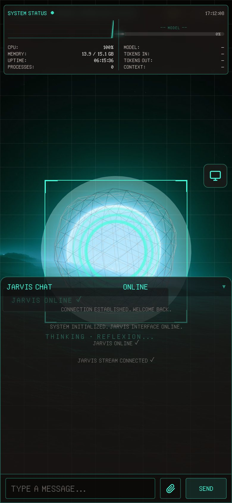

<div align="center">

# J.A.R.V.I.S

[English](README.md) · [Français](README.fr.md) · [Español](README.es.md) · [中文](README.zh-CN.md) · **हिन्दी** · [Português](README.pt-BR.md)

डेस्कटॉप के लिए एक वॉइस असिस्टेंट। यह सुनता है, जवाब देता है और आपके कंप्यूटर पर काम करता है:
Home Assistant, ईमेल, सॉफ़्टवेयर अपडेट, VPN, ऐप खोलना, स्क्रीन पढ़ना।

[**वेबसाइट**](https://lorenzoromabramanti-bot.github.io/jarvis/) · [**डाउनलोड**](../../releases/latest)


</div>

यह बिना किसी विंडो के बैकग्राउंड में चलता है, और किसी भी ऐप से कीबोर्ड द्वारा बुलाया जा सकता है।

---

## यह क्या करता है

**जवाब देना।** लोकल टूल्स की एक श्रृंखला पहले वह संभालती है जो उसे आता है — समय, गणना, यूनिट बदलना,
मशीन की जानकारी — **दो से छह मिलीसेकंड** में, किसी मॉडल को बुलाए बिना। बाकी सब मॉडल के पास जाता है।

**काम करना।** Home Assistant की लाइटें और प्लग, ईमेल छाँटना और जवाब का मसौदा बनाना, `winget` अपडेट,
VPN, सॉफ़्टवेयर हटाना, Spotify और Deezer को नियंत्रित करना। टैब, वीडियो, विंडो, लॉक और खुले ऐप सीधे
चलाए जाते हैं, मॉडल से होकर नहीं।

**जब पता न हो तो चुप रहना।** यह डिज़ाइन का फ़ैसला है, शिष्टाचार नहीं: जो असिस्टेंट कुछ किए बिना "हो गया"
कहता है, वह मना करने वाले से बदतर है। होम ऑटोमेशन में, Home Assistant द्वारा ठुकराई गई कार्रवाई को
विफलता के रूप में बताया जाता है।

**Gemini के बिना भी चलते रहना।** अगर Gemini जवाब नहीं देता, तो यह लोकल Ollama मॉडल पर चला जाता है। मॉडलों
की सूची असली Ollama सर्वर से पढ़ी जाती है।

**दूर से और बैकग्राउंड में काम करना।**

| | | |
|---|---|---|
| **Discord** | JARVIS से बात करें और आदेश दें; संवेदनशील काम से पहले यह पुष्टि माँगता है। यह वॉइस चैनल में भी जुड़ सकता है | `.env` में टोकन और ID |
| **सूचनाएँ** | बैकग्राउंड का काम पूरा होने पर Discord या Slack संदेश, शांत घंटों को छोड़कर | `.env` में webhook |
| **आज रात** | "यह आज रात करना": काम इंतज़ार करता है, रिपोर्ट सुबह की ब्रीफ़िंग के साथ आती है | |
| **उप-कार्य** | कई चीज़ों की तुलना वाला अनुरोध बाँटकर समानांतर में किया जाता है; 5 से ज़्यादा उप-कार्यों पर यह पूछता है | |
| **समय-सीमा तक** | जब तक समय बचा है, यह अपना काम दोबारा पढ़कर बेहतर करता है | |

**कोड लिखना।** यह कोडिंग का काम Claude Code, Codex, OpenCode, Cursor Agent या OpenClaw को सौंपता है, उस
प्रोजेक्ट में जिसे आपने घोषित किया है। उनके बिना, इसका अपना फ़ाइल एजेंट प्रोजेक्ट को पढ़ता, खोजता और
बदलता है, प्रोजेक्ट फ़ोल्डर के अंदर ही सीमित रहकर।

**हिसाब देना।** मॉडल के हर कॉल की लागत और टोकन दिखाई देते हैं। हर तरह की कार्रवाई के लिए भरोसे का लॉग:
स्वायत्तता कार्रवाई-दर-कार्रवाई कमाई जाती है, पहले से नहीं दी जाती।

**नज़र रखना।** वैकल्पिक क्षमताएँ, इंस्टॉलेशन के समय या सेटिंग्स में चुनें — सभी डिफ़ॉल्ट रूप से बंद:

| | | |
|---|---|---|
| **जोड़े गए कौशल** | वे कौशल देखें जो JARVIS ने खुद लिखे, किसी को हटाए बिना बंद करें, जानें कौन-सा टूटा है | "कौशलों की सूची", "कौशल *नाम* बंद करो" |
| **क्लिपबोर्ड** | अभी कॉपी किए गए टेक्स्ट का अनुवाद, सारांश, व्याख्या या सुधार — सुधरा टेक्स्ट वापस क्लिपबोर्ड में जाता है | "क्लिपबोर्ड का अनुवाद करो", "क्लिपबोर्ड सुधारो" |
| **विषयों पर नज़र** | चुने गए विषयों की दिन में एक बार जाँच; नई बातें सुबह की ब्रीफ़िंग में बताई जाती हैं, आपको बीच में टोके बिना | "AMD की घोषणाओं पर नज़र रखो", "तुम किस पर नज़र रख रहे हो?" |
| **सिस्टम रिमाइंडर** | टास्क शेड्यूलर को सौंपे जाते हैं: JARVIS बंद होने पर भी, रीस्टार्ट के बाद भी चलते हैं | कार्रवाई `rappel_os_creer` (HUD, iOS ऐप) |
| **Notion नोट्स** | नोट्स बनाना, पढ़ना, बदलना, हटाना और खोजना | `.env` में Notion टोकन |

### डिफ़ॉल्ट रूप से बंद विकल्प

कुछ सुविधाएँ किसी ख़ास व्यवस्था पर निर्भर हैं: एक घर, एक स्कूल, कोई बाहरी सेवा। ये **बंद** करके दी जाती हैं,
बिना किसी डिफ़ॉल्ट मान के। जब तक आप इन्हें सेट नहीं करते, ये कुछ नहीं करतीं और यह बताती हैं।

| | | |
|---|---|---|
| **समय-सारणी** | Pronote की कक्षाएँ एक अलग Google कैलेंडर में कॉपी, रद्द कक्षाएँ चिह्नित और समय खाली | Pronote इंटीग्रेशन के साथ Home Assistant, Google खाता |
| **दोहराई** | परीक्षा से एक दिन पहले तैयार क्विज़, और "मुझे दोहराई कराओ" | ऊपर की समय-सारणी, Ollama |
| **वेबकैम से उपस्थिति** | डेस्क के सामने से कोई गुज़रे तो Discord पर एक फ़ोटो | वेबकैम, Discord बॉट |
| **3D OSINT नक्शा** | JARVIS से God's Eye View और ShadowBroker खोलता है | ये दोनों प्रोग्राम, अलग से इंस्टॉल |
| **कोड सौंपना** | ऊपर *कोड लिखना* देखें | आपकी पसंद का कोडिंग एजेंट |

**किसी को चालू करने के लिए:** इंस्टॉलर (`installeur.py`) दोबारा चलाएँ, *क्षमताएँ* (Capacités) भाग में उसे चुनें,
फिर जो सेटिंग्स माँगी जाएँ उन्हें भरें। "उन्नत" चिह्नित विकल्प केवल उन्नत मोड में दिखते हैं। हर सेटिंग
`.env.example` में समझाई गई है।

## इंटरफ़ेस

<p align="center"></p>




एक 3D गोला जो JARVIS की आवाज़ पर प्रतिक्रिया देता है, चैट, मशीन की स्थिति, और टैब वाला एक *डेटा सेंटर*:
कार्य, कौशल, मेमोरी, शेड्यूल, मीडिया, दिनचर्या, घर, सुरक्षा, सेटिंग्स, नियंत्रण, एजेंट और सिस्टम।
**Agents** टैब मशीन पर मिले AI टूल्स (कोडिंग असिस्टेंट, MCP सर्वर, मॉडल इंजन) और उनमें से कौन चल रहे हैं,
यह दिखाता है।

यह फ़ोन के ब्राउज़र में भी चलता है।

यह इंटरफ़ेस **JincocoDev** के [openclaw-jarvis-ui](https://github.com/jincocodev/openclaw-jarvis-ui) पर बना है
(ISC लाइसेंस, देखें [`frontend/LICENSE`](frontend/LICENSE)), जो खुद **Filip Zrnzevic** के
[Three.js Orb Visualizer](https://codepen.io/filipz/pen/yyyRgry) पर आधारित है। इसे सीधे JARVIS से बात करने के
लिए दोबारा जोड़ा गया है।

इसके लिए **Node.js** चाहिए (22 LTS की सलाह, कम से कम 20.19)। पहली बार चलाने पर JARVIS खुद इसके पैकेज
इंस्टॉल करता है (`npm install`, एक-दो मिनट)। Node.js के बिना भी JARVIS आवाज़ और क्विक बार से काम करता है।

<br clear="right">

## इससे बात कैसे करें

| | |
|---|---|
| **आवाज़** | "Jarvis" कहें, फिर अनुरोध |
| **Ctrl+Alt+J** | किसी भी ऐप से, स्क्रीन के बीच में एक बार दिखती है |
| **HUD** | पूरा इंटरफ़ेस — घर, ईमेल, कैलेंडर, सुरक्षा, सेटिंग्स |

विंडो बंद करने से यह रुकता नहीं: यह घड़ी के पास एक आइकन के साथ बैकग्राउंड में चलता रहता है। इसे रोकने के
लिए: "quitter jarvis" (jarvis बंद करो) कहें, या उस आइकन का मेनू इस्तेमाल करें।

---

## इंस्टॉलेशन

**[रिलीज़](../../releases) पेज से इंस्टॉलर डाउनलोड करें और चलाएँ।** यह इस्तेमाल लायक Python ढूँढता है, नया
संस्करण लाता है, सब तैयार करता है, फिर सेटअप सहायक खोलता है।

| सिस्टम | फ़ाइल | स्थिति |
|---|---|---|
| Windows 10 / 11 | `Installer-JARVIS.exe` | परखा हुआ |
| Linux | `python3 amorceur/amorceur.py` | Ubuntu 26.04 पर परखा हुआ |
| macOS | `python3 amorceur/amorceur.py` | **असली Mac पर कभी नहीं आज़माया** — देखें [docs/macos.md](docs/macos.md) |

इंस्टॉलर 11 MB का है: यह JARVIS को साथ रखने के बजाय डाउनलोड करता है। इसलिए आप इंस्टॉल होने से पहले कोड
पढ़ सकते हैं — जो आपके कंप्यूटर को चलाने वाले प्रोग्राम के लिए मायने रखता है।

**Python 3.10 से 3.13** चाहिए। 3.14 बहुत नया है: कई निर्भरताओं का उसके लिए कंपाइल किया हुआ संस्करण अभी
नहीं है।

### हाथ से, अगर आप चाहें

```bash
git clone <रिपॉज़िटरी-URL> jarvis
cd jarvis
python -m venv venv
```

**Windows**
```bash
venv\Scripts\python.exe -m pip install -r requirements.txt
copy .env.example .env
venv\Scripts\python.exe installeur.py
```

**Linux / macOS**
```bash
venv/bin/python3 -m pip install -r requirements.txt
cp .env.example .env
venv/bin/python3 installeur.py
```

कभी भी यह जानने के लिए कि क्या कमी है (Windows पर `venv\Scripts\python.exe`, Linux/macOS पर
`venv/bin/python3`):

```bash
config.py
```

यह कमांड बताती है कि आपकी मशीन पर क्या उपलब्ध है और **कौन-सी सुविधाएँ अधूरी हैं, और क्यों**।

`requirements.txt` में Discord बॉट और वॉइस के लिए `discord.py`, `discord-ext-voice-recv` और `PyNaCl` भी हैं। ये तभी
काम आते हैं जब Discord टोकन सेट हो।

### आवाज़ पहचान अलग है

`requirements-voix.txt` कई गीगाबाइट का है (torch, Nemotron)। इसके बिना JARVIS कीबोर्ड, क्विक बार और HUD से
चलता है; सिर्फ़ डिक्टेशन नहीं होता, और यह बताता है।

## सेटिंग्स

दो ज़रूरी हैं, बाकी वैकल्पिक। `.env.example` बताता है कि हर एक किसलिए है और कहाँ से मिलेगा।

| | |
|---|---|
| `GEMINI_API_KEY` | मुख्य मॉडल। इसके बिना सिर्फ़ लोकल टूल्स जवाब देते हैं |
| `JARVIS_ACCESS_TOKEN` | WebSocket की रक्षा करता है, **जो सिस्टम कमांड चलाता है** |

दूसरा व्यवहार में वैकल्पिक नहीं है: इसके बिना प्रमाणीकरण बंद हो जाता है और मशीन का कोई भी प्रोग्राम JARVIS
को चला सकता है। इंस्टॉलर एक लंबा और रैंडम टोकन बनाता है।

---

## सिस्टम

**Windows 10 और 11** — यहीं बनाया और परखा गया।

**Linux, macOS** — JARVIS चालू होता है, पर कुछ सुविधाएँ उपलब्ध नहीं हैं: जो PowerShell, `winget`, रजिस्ट्री या
Windows API पर निर्भर हैं। वे बीच में विफल होने के बजाय **बताती हैं**, और `config.py` उनकी सूची देता है।

> macOS को कभी असली मशीन पर नहीं आज़माया गया। यहाँ जो लिखा है वह कोड का इरादा है, देखा हुआ नतीजा नहीं।

## निजता

आपके द्वारा सेट किए गए मॉडल, मौसम और Home Assistant के कॉल — और अगर आप चालू करें तो Discord, Slack, Notion
और Google Calendar — के अलावा कुछ भी मशीन से बाहर नहीं जाता।

बातचीत, कॉन्फ़िगरेशन और ईमेल लोकल रहते हैं। कुंजियाँ `.env` में रहती हैं, जिसे `git` अनदेखा करता है। HUD
स्क्रीन पर कुंजियाँ छिपाता है: उसे कभी उनका मान नहीं मिलता, सिर्फ़ यह कि वे मौजूद हैं।

अपरिवर्तनीय काम — ईमेल भेजना, सॉफ़्टवेयर हटाना — स्पष्ट सहमति माँगते हैं और करने से पहले **ठीक-ठीक दिखाते
हैं कि क्या जाने वाला है**।

## सुरक्षा

- **सुरक्षित WebSocket।** इंस्टॉलेशन पर एक टोकन बनता है। टोकन के बिना JARVIS सिर्फ़ लोकल मशीन पर सुनता है।
- **विकल्प बंद ही रहते हैं।** बिना चुना विकल्प बंद रहता है, इंस्टॉलर से गुज़रे बिना भी।
- **जोखिम वाले कामों से पहले पुष्टि।** अलार्म, ताला और PC का रिमोट कंट्रोल स्पष्ट सहमति माँगते हैं।
- **कोड सौंपना और रिमाइंडर।** किसी काम या रिमाइंडर का टेक्स्ट कभी कमांड की तरह नहीं चलाया जाता।

## अपडेट

मौजूदा संस्करण: **1.3.0**। बदलाव [NOTES-1.3.0.md](NOTES-1.3.0.md) में लिखे हैं।

शुरू होने पर JARVIS GitHub से पूछता है कि नया संस्करण है या नहीं, और बताता है। यह खुद कुछ इंस्टॉल नहीं करता।
यह जाँच चालू करने के लिए `.env` में `JARVIS_DEPOT` भरें; बंद करने के लिए खाली छोड़ दें।

---

## योगदान

प्रोजेक्ट दो नियम मानता है, जो कोड का रूप समझाते हैं:

**अनुपलब्ध सुविधा यह बताती है।** वह खाली सूची नहीं लौटाती, "हो गया" नहीं कहती, कोई डिफ़ॉल्ट मान नहीं गढ़ती।
इस रिपॉज़िटरी के ज़्यादातर सुधार कहीं न कहीं इस नियम के टूटने से आए हैं।

**जो कहा जाता है, वह जाँचा जाता है।** `_test_*.py` फ़ाइलें सीधे चलती हैं, बिना टेस्ट फ़्रेमवर्क के:

```bash
venv\Scripts\python.exe _test_machine.py
```

ये यह नहीं जाँचतीं कि कोड वही करता है जो करता है, बल्कि यह कि वह पहले की गलतियाँ नहीं दोहराता — प्रोग्राम को
जाम करने वाला एक वाक्य, कोड में लिखा हुआ एक नाम, वर्णक्रम में की गई संस्करणों की तुलना।

## लाइसेंस

तय होना बाकी है। `frontend/` फ़ोल्डर का इंटरफ़ेस ISC लाइसेंस (JincocoDev) के तहत है।
